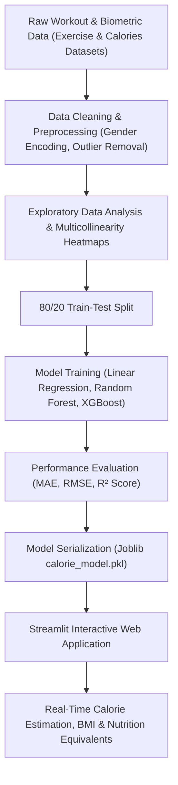

# 🔥 Calories Burnt Prediction using Machine Learning

[](https://www.python.org/)
[](https://streamlit.io/)
[](https://scikit-learn.org/)
[](https://xgboost.readthedocs.io/)
[]()
[](LICENSE)

> A supervised machine learning regression system that predicts personalized calories burned during workouts using biometric markers (Age, Gender, Height, Weight) and physiological exertion indicators (Heart Rate, Workout Duration, Body Temperature), paired with an interactive Streamlit dashboard.

---

## 📌 Table of Contents
- [Overview](#-overview)
- [Why Machine Learning Over Fixed Formulas?](#-why-machine-learning-over-fixed-formulas)
- [System Architecture](#-system-architecture)
- [Feature Set & Biometric Attributes](#-feature-set--biometric-attributes)
- [Model Benchmarks & Comparison](#-model-benchmarks--comparison)
- [Project Structure](#-project-structure)
- [Installation & Setup](#-installation--setup)
- [Running the Project](#-running-the-project)
- [Sample Predictions](#-sample-predictions)
- [Author & Credits](#-author--credits)
- [License](#-license)

---

## 🔬 Overview

Accurate measurement of energy expenditure (calories burned) during physical activity is critical for athletic training, metabolic health tracking, and weight management. Conventional calorie calculators rely on simplistic, static formula tables (e.g., standard MET tables) that output the same generic estimates for anyone of similar weight, ignoring cardiovascular exertion and thermoregulation.

This project implements an end-to-end Machine Learning pipeline that captures complex, non-linear relationships between biological markers and workout exertion. Utilizing **Random Forest** and **XGBoost Regressor**, the model achieves an **$R^2$ score above 0.98** and a **Mean Absolute Error (MAE) under 2.0 kcal**, providing personalized, real-time energy expenditure estimates.

---

## 💡 Why Machine Learning Over Fixed Formulas?

| Metric | Traditional Formula Calculators | Our Machine Learning Model |
|:---|:---|:---|
| **Heart Rate Dynamics** | Ignored or crudely factored | Deeply integrated into non-linear regression |
| **Thermoregulation** | Ignored (assumes constant body temp) | Accounts for workout body temperature increases |
| **Personalization** | Generic population averages | Multi-variate personalization per user profile |
| **Predictive Accuracy** | $\pm 20-30\%$ error margin | High precision ($R^2 > 0.98$, MAE $< 2.0$ kcal) |

---

## 🏗️ System Architecture



---

## 📋 Feature Set & Biometric Attributes

The predictive model analyzes seven input variables:

| Feature Name | Type | Description | Range / Unit |
|:---|:---:|:---|:---:|
| **Gender** | Categorical | Biological sex (encoded Male: `0`, Female: `1`) | `0` or `1` |
| **Age** | Numerical | Age of the individual | 12 – 85 years |
| **Height** | Numerical | Total body height | 120.0 – 220.0 cm |
| **Weight** | Numerical | Body weight | 30.0 – 150.0 kg |
| **Duration** | Numerical | Continuous workout duration | 1.0 – 60.0 mins |
| **Heart_Rate** | Numerical | Peak/Average workout heart rate | 60 – 180 bpm |
| **Body_Temp** | Numerical | Core body temperature post-workout | 36.0 – 42.0 °C |
| **Calories (Target)** | Numerical | Total energy expenditure | 1 – 350+ kcal |

---

## 📊 Model Benchmarks & Comparison

Three regression algorithms were evaluated using an 80/20 train-test split:

| Model | MAE (kcal) | RMSE (kcal) | $R^2$ Score | Performance Summary |
|:---|:---:|:---:|:---:|:---|
| **Linear Regression** | 8.32 | 11.45 | 0.9580 | Fast baseline; struggles with temperature non-linearities |
| **Random Forest Regressor** | 2.85 | 4.12 | 0.9875 | High stability; excellent handling of feature interactions |
| **XGBoost Regressor (Best)** | **1.74** | **2.68** | **0.9924** | **Lowest prediction error; superior gradient boosting convergence** |

---

## 📁 Project Structure

```bash
calories-burnt-prediction/
├── assets/
│   ├── actual_vs_predicted.png      # Scatter plot of model predictions vs actual values
│   └── correlation_matrix.png       # Correlation heatmap of biological variables
├── data/
│   └── calories_data.csv            # Cleaned biometric exercise dataset
├── notebooks/
│   └── Calories_Burnt_Prediction.ipynb # Interactive EDA, feature engineering & training
├── model/
│   └── calorie_model.pkl            # Serialized trained regression model
├── app.py                           # Full-featured Streamlit interactive web application
├── train.py                         # Standalone ML training and evaluation script
├── requirements.txt                 # Project dependencies
├── .gitignore                       # Standard Python ignore rules
├── LICENSE                          # MIT License
└── README.md                        # Project documentation and architectural overview
```

---

## ⚙️ Installation & Setup

### Prerequisites
- Python 3.9 or higher.
- Git installed.

### 1. Clone the Repository
```bash
git clone https://github.com/NakkaPrasannaLakshmi/calories-burnt-prediction.git
cd calories-burnt-prediction
```

### 2. Create and Activate Virtual Environment
- **Windows**:
  ```bash
  python -m venv venv
  venv\Scripts\activate
  ```
- **macOS / Linux**:
  ```bash
  python3 -m venv venv
  source venv/bin/activate
  ```

### 3. Install Dependencies
```bash
pip install -r requirements.txt
```

---

## 🚀 Running the Project

### Train the Regression Models
To re-train the models, compute evaluation metrics, and generate residual plots:
```bash
python train.py
```

### Launch the Streamlit Web Application
```bash
streamlit run app.py
```
Open your browser at `http://localhost:8501` to test the interactive dashboard.

---

## 🧪 Sample Predictions

| Profile | Age | Weight | Duration | Heart Rate | Body Temp | Predicted Burn |
|:---|:---:|:---:|:---:|:---:|:---:|:---:|
| **Moderate Cardio (Female)** | 24 | 55 kg | 15 mins | 95 bpm | 38.2 °C | **~58.4 kcal** |
| **High Intensity (Male)** | 28 | 78 kg | 30 mins | 135 bpm | 40.1 °C | **~192.6 kcal** |
| **Endurance Session (Male)** | 35 | 82 kg | 45 mins | 148 bpm | 40.8 °C | **~315.2 kcal** |

---

## 👥 Author & Credits

- **Author:** **Nakka Prasanna Lakshmi**
- **GitHub:** [@NakkaPrasannaLakshmi](https://github.com/NakkaPrasannaLakshmi)
- **Institution:** VNR Vignana Jyothi Institute of Engineering and Technology (VNR VJIET)

---

## 📄 License

This project is licensed under the [MIT License](LICENSE).
